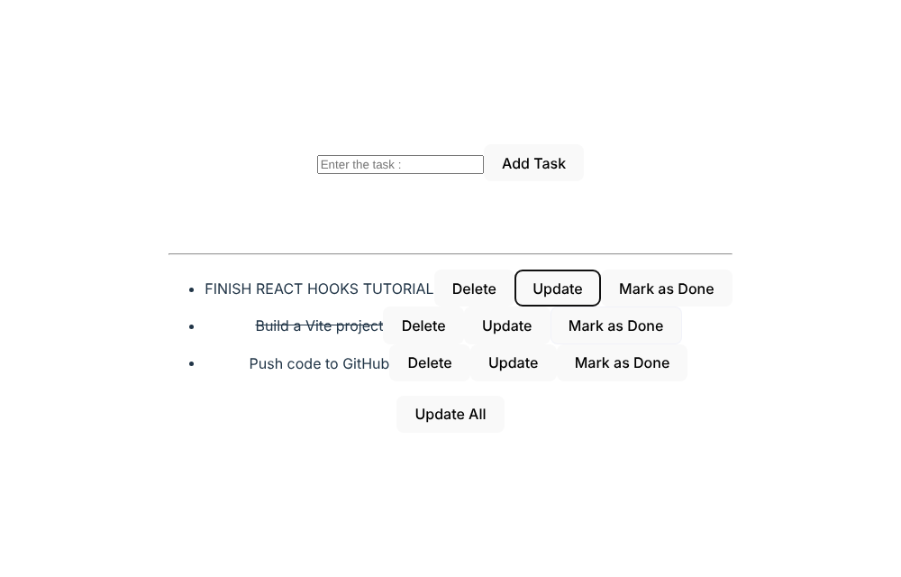
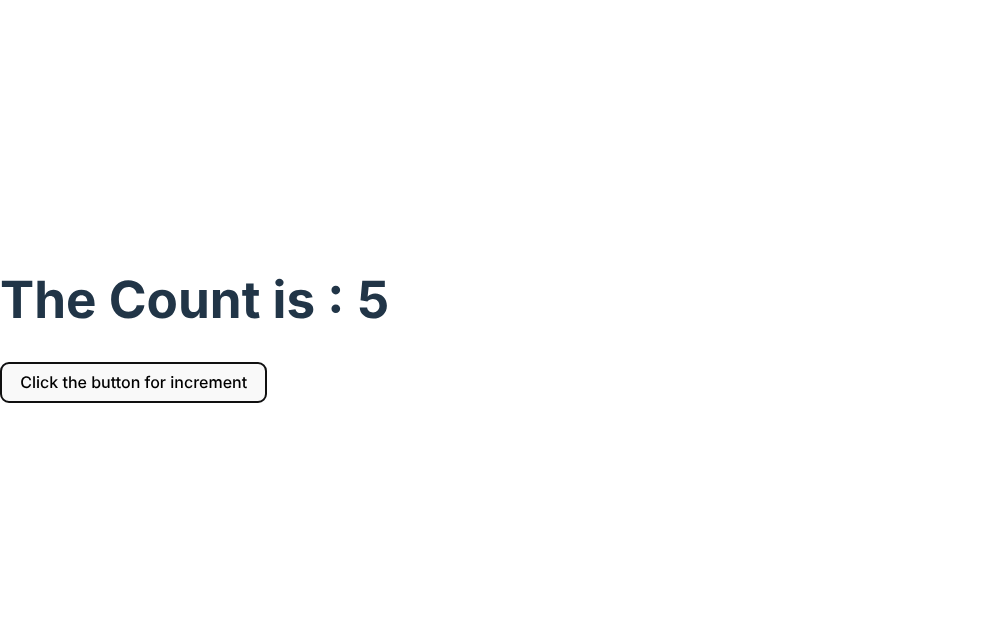
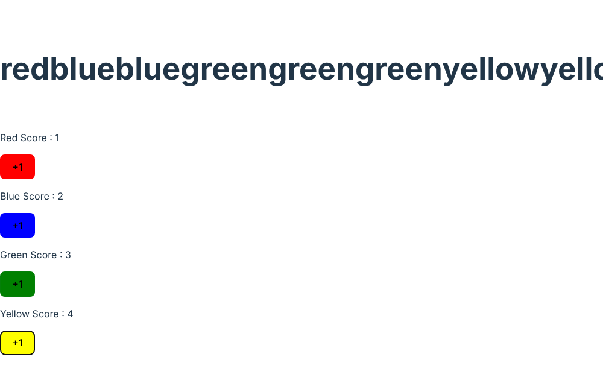
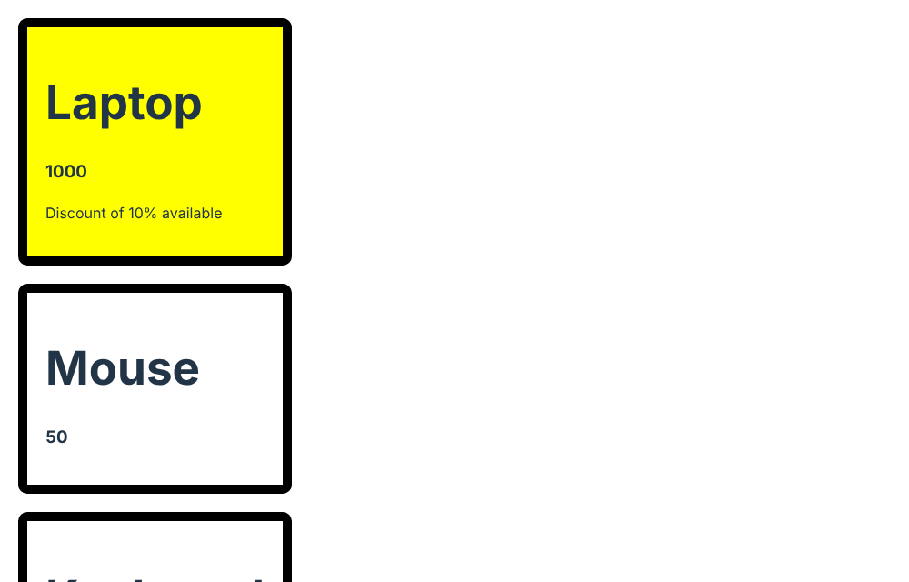

# React Fundamentals (Vite)

Learning project for core React concepts, built with Vite. The app lives in [`my-react-app/`](my-react-app).

## What it covers

Small components, each demonstrating one idea:

| Component | Concept |
|---|---|
| `Title`, `Paragraph` | Basic components and JSX |
| `Button` | Event handlers (click, double-click, mouse over/out) |
| `Counter` | State with `useState` |
| `Product`, `ProductTab` | Props and conditional rendering (`Product.css`) |
| `Ludo` | Object and array state (per-colour scores) |
| `TodoList` | Controlled inputs, list state, unique ids with `uuid` (currently rendered by `App.jsx`) |

## Screenshots

| Todo list (rendered by `App.jsx`) | Counter (`useState`) |
|:---:|:---:|
|  |  |
| **Ludo scores (object + array state)** | **Products (props + conditional rendering)** |
|  |  |

## Tech stack

React 19 · Vite 7 · ESLint 9 · uuid

## Run locally

Requires Node.js 20.19+ (Vite 7).

```bash
cd my-react-app
npm install
npm run dev        # development server
npm run build      # production build
npm run lint       # ESLint
```

To view another component, change which one `src/App.jsx` imports and renders.

## Author

Sanket Mali · [GitHub](https://github.com/Sanket1516)
